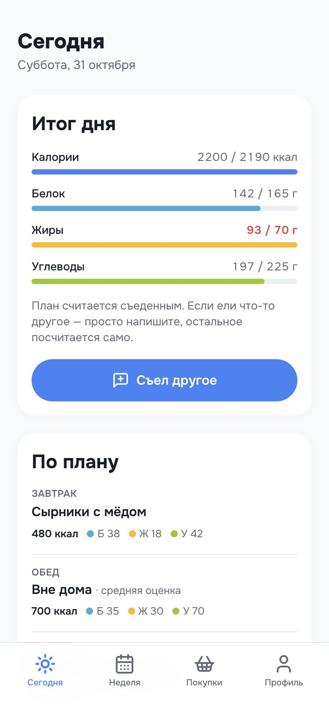
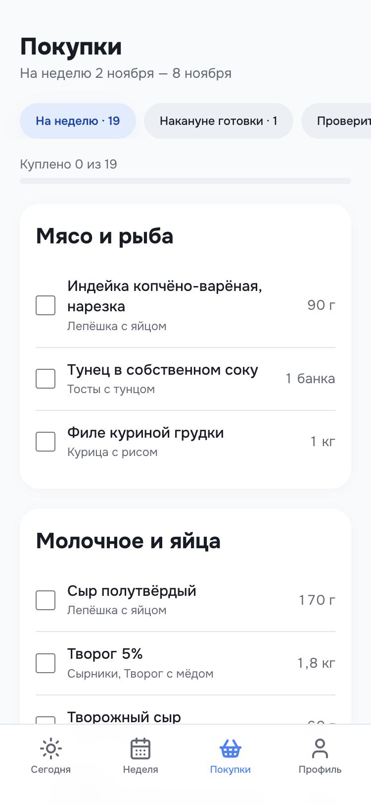
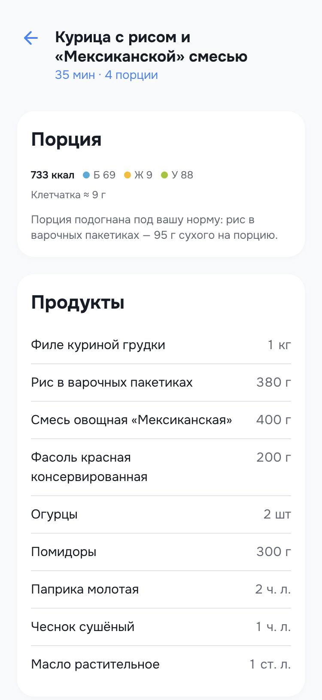

# Meal-prep planner

План еды на неделю за 3 минуты: норма КБЖУ под цель, меню под ваше расписание, список покупок и учёт, который почти не требует действий.

**Демо:** https://ananakimov.github.io/meal-prep-planner/ — кнопка «Посмотреть на демо-профиле» сразу показывает готовую неделю.

<p>
  
  
  
  
  
</p>

Pet-проект для портфолио: не продаётся, данные остаются в браузере.

## Проблема

Люди с целью по телу — похудеть, набрать, рекомпозиция — обычно знают, *что* нужно делать. Срываются они не на готовке, а на **планировании**: решить, что готовить на неделю, сколько класть в порцию и что купить, — это время и голова. Без плана человек заказывает доставку или перекусывает.

**Для кого:** работают полный день, готовы готовить сами 1–2 раза в неделю, продукты заказывают онлайн, часть приёмов пищи — вне дома.

**Почему не подходят существующие решения:**

| Альтернатива | Чего не хватает |
| --- | --- |
| Трекеры калорий | Считают съеденное задним числом и не говорят, что есть; ручной учёт каждого приёма быстро бросают |
| Сайты с рецептами | Не учитывают норму, ограничения и расписание; план и покупки — вручную |
| Доставка рациона | Решает всё, но стоит в разы дороже, чем готовить самому |

Продуктовый документ с CJM и гипотезами: [Meal-prep planner: проблема, CJM, MVP](https://claude.ai/artifact/ALPM98QkVDhQGq7ahnNroR).

## Ключевые решения

1. **Учёт по умолчанию.** План считается съеденным. Вносить нужно только отклонения: «вместо ужина шаурма» — ИИ оценит КБЖУ и заменит приём. Именно на подсчёте каждого приёма пищи люди бросают трекеры.
2. **Готовка на 2 дня.** Каждая готовка — 4 порции: обед и ужин на этот и следующий день. Дни вне дома в план не попадают.
3. **Завтраки блоками.** Один завтрак 2 дня подряд — сырники или намазку можно сделать сразу на два утра.
4. **Порция под норму.** Сначала меняется гарнир (рис, макароны) в пределах 50–160%, если не хватает — вся порция в пределах 70–140%. Тесты держат дневные калории в ±100 ккал от нормы для разных профилей.
5. **Сырое мясо — отдельным списком.** Если вторая готовка в четверг, фарш на неё покупается в среду: в холодильнике он живёт 1–2 дня.
6. **С субботы планируется следующая неделя.** Покупки обычно делают на выходных — «Неделя» и «Покупки» в субботу и воскресенье показывают следующую неделю.
7. **Корзина через агента.** Ссылку на корзину ВкусВилла может создать только их MCP, поэтому эта часть вынесена в [агента](agent/) для Claude.

Все решения выросли из реального использования: первым пользователем был автор, и каждое ограничение — «не ем каши», «нет духовки», «рецепт не дольше 40 минут», «рис только в пакетиках» — пришло из жизни, а не из головы.

## Что внутри

- **Онбординг:** параметры, активность и цель, норма с пошаговым объяснением по формуле Миффлина — Сан Жеора, ограничения (что не ест, техника, время), любимые блюда, расписание «дни × приёмы пищи» и дни готовки.
- **Сегодня:** итог дня план/факт, напоминания «сегодня готовка», «купить к завтрашней готовке», «вечером сырники на 2 утра».
- **Неделя:** готовка, завтраки и обеды по дням, замена любого блюда на подходящее под ограничения.
- **Покупки:** на неделю, накануне готовки, «проверить дома»; галочки сохраняются по неделе.
- **Рецепт:** продукты на 4 порции с учётом подгонки, шаги, «если не получается».
- **Профиль:** норма, вес и средний за 7 дней, ключ Claude API, экспорт и импорт JSON.

«Съел другое» работает на `claude-haiku-5-5` через структурированный ответ. Ключ вводит сам пользователь, он хранится только в браузере и отправляется только в Anthropic. Без ключа доступен ручной ввод.

## Стек

Vite, React 18, TypeScript, Tailwind CSS, React Router (HashRouter для GitHub Pages), `@anthropic-ai/sdk` + zod, Vitest. Бэкенда нет: состояние в `localStorage`. Деплой — GitHub Actions → GitHub Pages.

```
src/
  lib/          логика без UI: nutrition, plan, shopping, recipes, claude, storage
  data/         банк рецептов (recipes.json)
  pages/        экраны
  components/   компоненты дизайн-системы
  state/        контекст приложения
agent/          skill для Claude + ВкусВилл MCP
docs/           дизайн-система и скриншоты
```

## Запуск

```bash
npm install
npm run dev
```

```bash
npm test
```

```bash
npm run build
```

## Агент для корзины

[`agent/`](agent/) — skill для Claude Code или claude.ai. Агент проходит тот же онбординг диалогом (или берёт экспорт из приложения), подбирает рецепты в том числе из базы ВкусВилла и собирает две ссылки на корзину: основную и с мясом ко второй готовке.

## Что дальше

- Пересчёт нормы по среднему весу за 2 недели — автоматически, а не советом.
- Автоплан следующей недели из блюд, которые понравились.
- Учёт по фото через vision-модель.
- Проверка гипотез из продуктового документа на 5–10 людях из аудитории.

Дизайн-система описана в [`docs/design-system.md`](docs/design-system.md).
